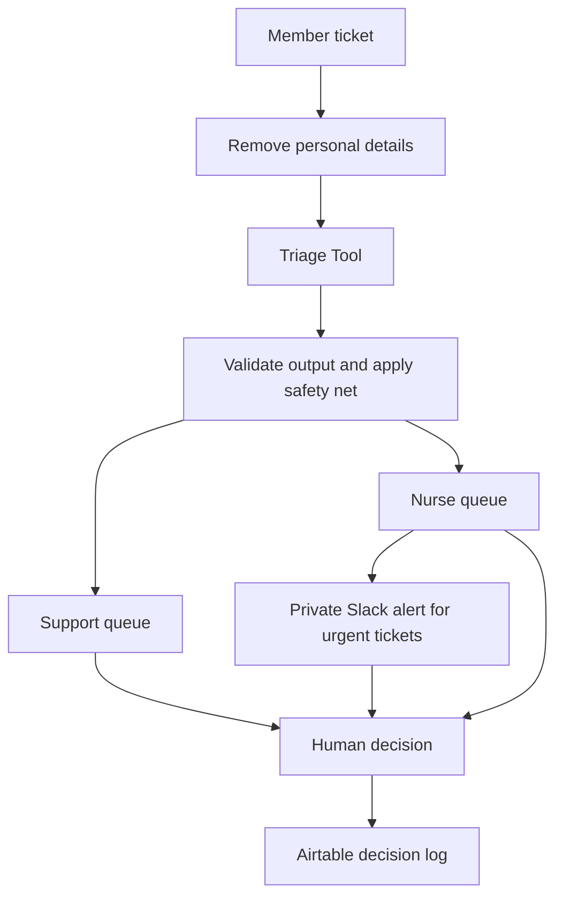

# Carevine Triage Tool

An AI Triage Tool for Carevine Health, a fictional virtual chronic-care company. This is a concept project with synthetic data only. Sending a reply or calling a member records a simulated action; it does not contact anyone.

Built by **Dan Mota**, using **Codex for AI-assisted development**.

[Live demo](https://carevine-triage.vercel.app) · [Build handoff](docs/HANDOFF.md)

## The problem

In the fictional scenario, monthly tickets grew from **1,150 to 3,200**. First response time grew from **4.5 hours to 14 hours**, and clinical messages took **22 hours to reach a nurse**. Support reps were sorting health questions alongside account, device, billing and scheduling requests.

The tool helps route messages and draft routine replies from the help center. It keeps decisions with people.

## How it works



The server removes names and other personal details before an AI call. OpenAI returns a strict JSON schema; invalid output gets one retry. Code applies a crisis pattern check and removes every crisis or clinical draft. The helpdesk restores the member's first name locally and discards drafts with leftover redaction tags. Failed model calls leave a ticket for a support rep to handle.

Support reps review, edit, reject or send a draft, write their own reply, change a category, or send a ticket to a nurse with a reason. Nurses claim tickets, use the fixed crisis template, log calls, reply directly, or send a non-clinical ticket back. Confirmed actions write a Decisions row. These choices matter because a plausible AI answer can still be wrong, and clinical decisions need a qualified person.

## Test results

The test set contains **16 synthetic tickets**: seven draft cases, four help center handoffs, and five clinical or crisis cases. The runner checks routing, draft suppression and privacy; Dan reviews draft accuracy separately.

| Recorded run | Automatic checks | Drafts judged accurate |
| ------------ | ---------------- | ---------------------- |
| Run 1        | 13/16            | —                      |
| Run 2        | 16/16            | 7/7                    |

Run 1 exposed two prompt issues: missing or unsynced readings were treated as clinical without a value or symptoms, and the tool did not consistently compare all matching articles for conflicting facts. Both instructions were corrected before run 2. These are Dan's recorded model test results, not a measure of clinical performance.

The protected `/admin/tests` runner sends one request per ticket, shows progress, lets a reviewer mark each draft ✓/✗, and saves the run to Airtable. Publishing a run explicitly replaces the cached public demo results. Local verification also covers crisis patterns, redaction, validation, authentication, decision logging and limits, plus keyboard and 390px browser walkthroughs.

## Privacy and cost

- Personal details are redacted before every model call. Secrets and provider calls stay on the server. Slack alerts contain a ticket ID and scrubbed reason, never the member's name or message text.
- Public pages make **no model calls**. They use cached Airtable results, shared for five minutes, or an offline fallback. Model runs require an admin password and signed cookie.
- Each visitor has a private tab session. Queue changes do not change another visitor's tickets. **Reset demo** restores the session and wait clock without API calls.
- Decisions are batched. Public sessions allow 100 Decision rows, 10 KB Gap rows and three Slack alert attempts; a server-instance burst gate allows 30 write requests per minute. Limits survive reset, and the row/Slack totals are checked in Airtable. At a limit, visitors can keep exploring locally.
- Airtable's [Free plan allows 1,000 API calls per workspace per month](https://support.airtable.com/articles/7735693959-managing-api-call-limits-in-airtable), with five requests per second per base. Caching and limits reduce usage; they are basic demo guardrails, not a global traffic budget.

## Stack

Next.js App Router, React, TypeScript and Tailwind; OpenAI Responses API with Structured Outputs and Zod validation; Airtable REST API; Slack Block Kit incoming webhook; Vercel hosting. The small provider wrapper is `src/lib/llm.ts`. `TRIAGE_MODEL` selects the model, with `gpt-6-luna` as the default.

## Run locally

Use Node.js 20.9 or newer.

```sh
npm ci
cp .env.example .env.local
npm run dev
```

Open [localhost:3000](http://localhost:3000). With no Airtable configuration, the public demo uses the bundled synthetic tickets and cached mock results.

For connected features, fill in `.env.local` with your own credentials:

| Variable                             | Purpose                                                           |
| ------------------------------------ | ----------------------------------------------------------------- |
| `ADMIN_PASSWORD`                     | Protect admin pages, server actions and APIs                      |
| `AIRTABLE_TOKEN`, `AIRTABLE_BASE_ID` | Read/write the five helpdesk tables; schema permissions for setup |
| `OPENAI_API_KEY`                     | Admin-only live triage                                            |
| `TRIAGE_MODEL`                       | Optional model override                                           |
| `SLACK_WEBHOOK_URL`, `APP_URL`       | Slack alerts and the HTTPS app origin for nurse links             |

Credentials are server-only; `.env.local` is ignored by Git. Configure the same values in Vercel. Table setup and the exact live-test steps are in [HANDOFF §§16–18](docs/HANDOFF.md#16-admin-setup-steps-after-phase-2-deployment). Seeding deletes existing Decisions; it is unnecessary for reviewing an already configured demo.

```sh
npm test
npm run typecheck
npm run build
npm start
```

Read [AGENTS.md](AGENTS.md) and the handoff before changing the project. Approved screen references are in `design/`.
